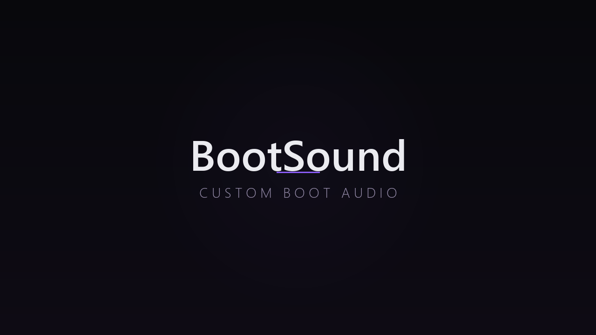

# Nintendo Switch · BT & Beats — Sonido y controles

**Creé este proyecto para personalizar el sonido y las imágenes de arranque de mi Nintendo Switch y sincronizar mis Pro Controller y Joy-Con compatibles de Original a Hack.**

El sonido se reproduce al arrancar Hack. La sincronización Bluetooth se ejecuta cuando abres el payload desde Hekate. Puedes instalar cada función por separado en tu Nintendo Switch con Atmosphère y emuMMC.

| Componente | Para qué sirve | Instalación |
|---|---|---|
| **Sonido de arranque** | Reproducir un sonido al entrar a Hack. Incluyo el sonido Yoshi que uso y un ejemplo generado. | [Guía de sonido](docs/SONIDO.md) |
| **Arranque e imágenes** | Personalizar las pantallas de arranque con diseños, un logo para Hekate y herramientas para Atmosphère. | [Guía de imágenes](docs/ARRANQUE.md) |
| **Sincronización de controles** | Importar los Pro Controller/Joy-Con compatibles de Original a Hack en **la misma consola**, al abrir el payload. | [Guía Bluetooth](docs/BLUETOOTH.md) |

## Empezar

1. Descarga el ZIP de la última versión desde [Releases](https://github.com/JheraldC/Nintendo-Switch-BT-Sound/releases/latest) y extrae su contenido en tu ordenador.
2. Conecta la microSD de una Switch que ya arranque correctamente con Hekate, Atmosphère y emuMMC. Guarda un respaldo de los archivos que vayas a cambiar.
3. Elige qué quieres instalar: sonido de arranque, imágenes o sincronización de controles. Abre su guía en la tabla de arriba para revisar los requisitos y preparar los archivos.
4. Sigue los pasos de esa guía para instalar el componente en la microSD y comprobarlo en la consola. Puedes instalar cada componente por separado.

El sonido y el logo de Hekate incluyen archivos preparados para instalar. **La sincronización Bluetooth necesita prepararse y compilarse para la SD de cada consola**; su guía explica el proceso. Las guías también indican las herramientas necesarias y cómo volver a la configuración anterior.

## Cómo funciona el payload Bluetooth

Abre **Hekate → Payloads → BT-Sync-Una-Vez.bin** para sincronizar los controles. La pantalla muestra el progreso y el resultado: **OK en verde** o **FALLO en rojo**. Al terminar, vuelve automáticamente al menú de Hekate.

Después entra en **Sistema Hack**. Puedes volver a ejecutar el payload cuando quieras importar controles que hayas emparejado en Original.

## Requisitos

- Para Bluetooth: **Original 23.0.1**, SD **FAT32**, emuMMC habilitada, base Bluetooth externa existente y **Hekate 6.5.4 exacto**.
- Cada consola necesita sus propias claves locales y un payload preparado para su SD.

[Reversión](docs/REVERSION.md) · [Licencias y créditos](LICENSES.md)

