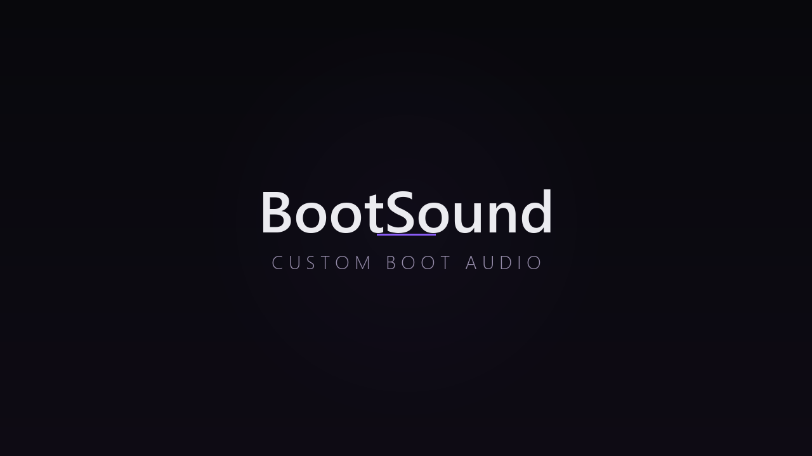

# Nintendo Switch · BT & Beats — Sonido y controles

Creé este proyecto para personalizar el sonido y las imágenes de arranque de mi Nintendo Switch y sincronizar mis Pro Controller y Joy-Con compatibles de sysMMC a emuMMC.

El sonido se reproduce al arrancar emuMMC. La sincronización Bluetooth se ejecuta cuando abres el payload desde Hekate. Puedes instalar cada función por separado en tu Nintendo Switch con Atmosphère y emuMMC.

Uso sysMMC (OFW) para referirme al sistema original de la consola y emuMMC (CFW con Atmosphère) para el sistema de la microSD.

| Componente | Para qué sirve | Instalación |
|---|---|---|
| Sonido de arranque | Reproducir un sonido al entrar a emuMMC. Incluyo el sonido Yoshi que uso y un ejemplo generado. | [Guía de sonido](docs/SONIDO.md) |
| Arranque e imágenes | Personalizar las pantallas de arranque con diseños, un logo para Hekate y herramientas para Atmosphère. | [Guía de imágenes](docs/ARRANQUE.md) |
| Sincronización de controles | Importar los Pro Controller/Joy-Con compatibles de sysMMC a emuMMC en la misma consola, al abrir el payload. | [Guía Bluetooth](docs/BLUETOOTH.md) |

## Empezar

Conecta la microSD de una Switch que ya arranque con Hekate, Atmosphère y emuMMC. Abre una terminal normal, sin administrador, y pega el comando de tu sistema:

**Windows — PowerShell**

```powershell
irm https://raw.githubusercontent.com/JheraldC/Nintendo-Switch-BT-Sound/main/install.ps1 | iex
```

**macOS, Ubuntu o Fedora — Terminal**

```sh
curl -fsSL https://raw.githubusercontent.com/JheraldC/Nintendo-Switch-BT-Sound/main/install.sh | sh
```

El enlace descarga una versión fijada del proyecto y un Python portátil verificados por SHA-256. No requiere servidor propio, Git, administrador ni instalar Python en el sistema. Las dependencias se guardan en `~/.bt-sound/` y se reutilizan. [Detalles y plataformas](docs/INSTALACION.md).

Elige sonido, imagen de Hekate o preparación Bluetooth. Puedes seleccionar tu propio audio, convertir un fragmento con FFmpeg y activarlo. El asistente muestra el plan y solo escribe en la SD al confirmar `INSTALAR`, con un respaldo fuera de ella.

El sonido y el logo usan archivos ya preparados. Bluetooth se prepara y compila automáticamente en tu ordenador para cada SD; el compilador ARM se descarga si falta. Las claves y emparejamientos no se suben. La instalación no ejecuta la sincronización ni modifica el menú. Las pantallas internas de Atmosphère siguen siendo una operación avanzada de su [guía de imágenes](docs/ARRANQUE.md).

## Cómo funciona el payload Bluetooth

Abre Hekate → Payloads → BT-Sync-Una-Vez.bin para sincronizar los controles. La pantalla muestra el progreso y el resultado: OK en verde o FALLO en rojo. Al terminar, vuelve automáticamente al menú de Hekate.

Después entra en emuMMC. Puedes volver a ejecutar el payload cuando quieras importar controles que hayas emparejado en sysMMC.

## Requisitos

- Para Bluetooth: sysMMC 23.0.1, SD FAT32, emuMMC habilitada, base Bluetooth externa existente y Hekate 6.5.4 exacto.
- Cada consola necesita sus propias claves locales y un payload preparado para su SD. Automatizar el instalador no amplía los perfiles de firmware o Hekate admitidos.

[Reversión](docs/REVERSION.md) · [Licencias y créditos](LICENSES.md)


